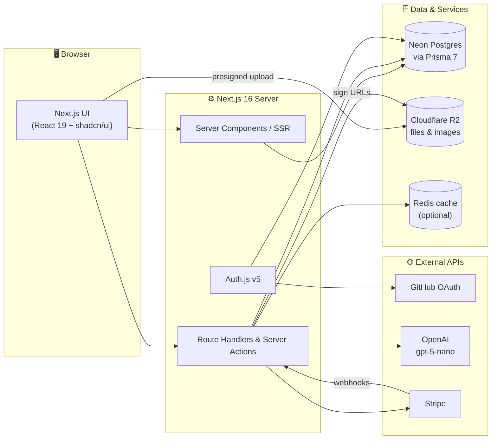
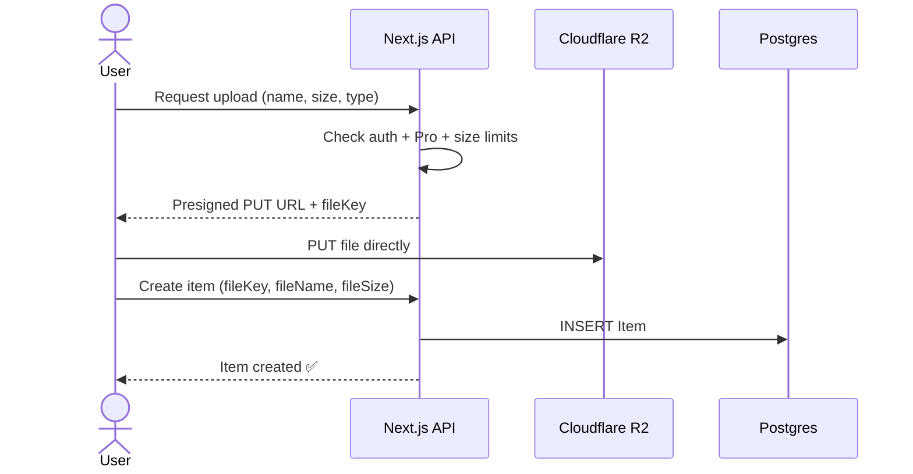
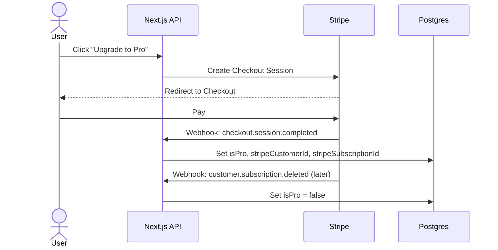
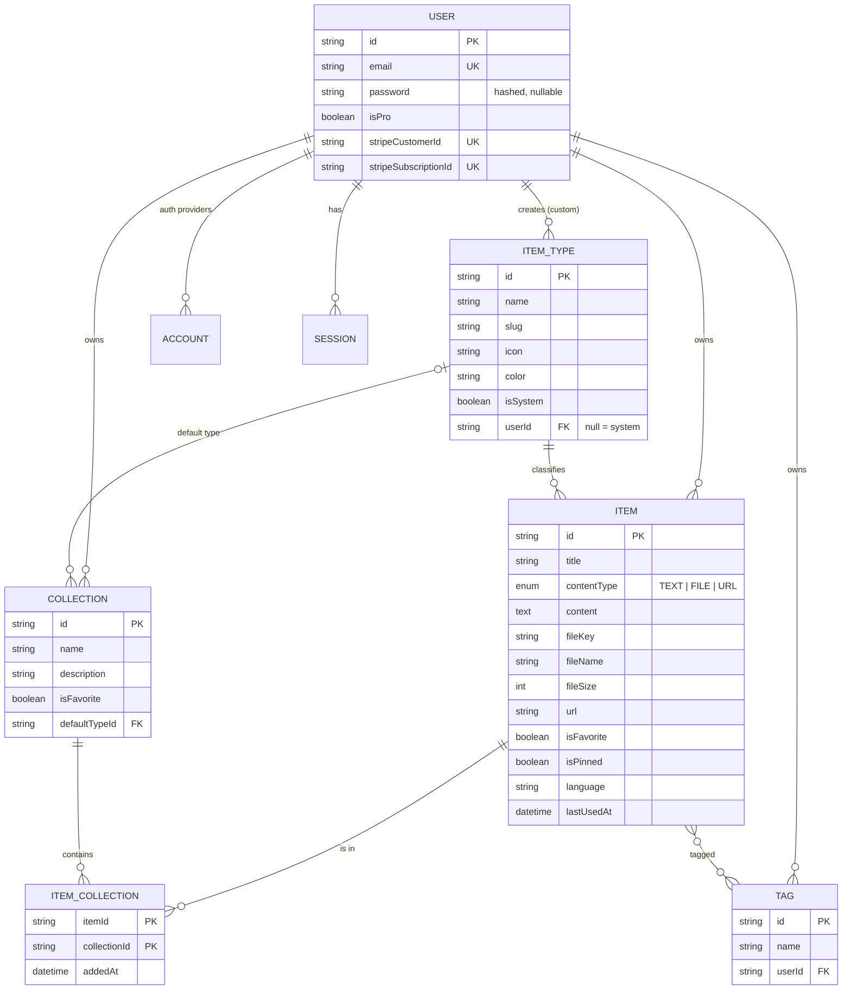

# 🗃️ DevStash — Project Overview

> **One fast, searchable, AI-enhanced hub for all your dev knowledge and resources.**

---

## 📌 Table of Contents

1. [Problem](#-problem)
2. [Target Users](#-target-users)
3. [Features](#-features)
4. [Tech Stack](#-tech-stack)
5. [Architecture](#-architecture)
6. [Data Model](#-data-model)
7. [Prisma Schema (Draft)](#-prisma-schema-draft)
8. [Routes](#-routes)
9. [Monetization](#-monetization)
10. [UI / UX](#-ui--ux)
11. [Development Rules](#-development-rules)
12. [Roadmap](#-roadmap)
13. [Open Questions](#-open-questions)
14. [Reference Links](#-reference-links)

---

## 🧩 Problem

Developers keep their essentials scattered across too many places:

| What | Where it usually lives |
|---|---|
| Code snippets | VS Code, Notion |
| AI prompts | Chat histories |
| Context files | Buried in projects |
| Useful links | Browser bookmarks |
| Docs | Random folders |
| Commands | `.txt` files |
| Project templates | GitHub Gists |
| Terminal commands | Bash history |

**Result:** context switching, lost knowledge, and inconsistent workflows.

**DevStash** gives developers **one** place to save, find, and reuse all of it, fast.

---

## 👥 Target Users

| Persona | Needs |
|---|---|
| 🧑‍💻 **Everyday Developer** | Quickly grab snippets, prompts, commands, links |
| 🤖 **AI-first Developer** | Save prompts, contexts, workflows, system messages |
| 🎓 **Content Creator / Educator** | Store code blocks, explanations, course notes |
| 🏗️ **Full-stack Builder** | Collect patterns, boilerplates, API examples |

---

## ✨ Features

### A. Items & Item Types

Every item has a **type**. DevStash ships with fixed **system types** (they can't be edited or deleted). **Custom types** come later as a Pro feature.

| Type | Content kind | Icon ([Lucide](https://lucide.dev/icons)) | Color | Plan | Route |
|---|---|---|---|---|---|
| Snippet | `TEXT` | `Code` | 🔵 `#3b82f6` | Free | `/items/snippets` |
| Prompt | `TEXT` | `Sparkles` | 🟣 `#8b5cf6` | Free | `/items/prompts` |
| Note | `TEXT` | `StickyNote` | 🟡 `#fde047` | Free | `/items/notes` |
| Command | `TEXT` | `Terminal` | 🟠 `#f97316` | Free | `/items/commands` |
| Link | `URL` | `Link` | 🟢 `#10b981` | Free | `/items/links` |
| File | `FILE` | `File` | ⚪ `#6b7280` | **Pro** | `/items/files` |
| Image | `FILE` | `Image` | 🩷 `#ec4899` | **Pro** | `/items/images` |

- Items are created and viewed in a **quick-access drawer**, so you never leave the current page.
- Text types use a **Markdown editor** with syntax highlighting.
- File types support **upload** to Cloudflare R2.

### B. Collections

- A collection can hold items of **any type**.
- **Many-to-many:** one item can be in several collections (e.g. a React snippet in both *React Patterns* and *Interview Prep*).
- You can see which collections an item belongs to, and add it to or remove it from several at once.

Examples:

- 📁 **React Patterns**: snippets, notes
- 📁 **Context Files**: files
- 📁 **Python Snippets**: snippets

### C. Search 🔍

Search across **titles, content, tags, and types**.
*Suggested implementation:* Postgres full-text search (`tsvector`) plus `pg_trgm` for fuzzy title matching. No separate search service is needed at launch.

### D. Authentication 🔐

- Email + password
- GitHub OAuth

### E. Other Features

- ⭐ Favorite collections and items
- 📌 Pin items to the top
- 🕒 Recently used items
- 📥 Import code from a file
- 📝 Markdown editor for text types
- 📤 File upload for file and image types
- 💾 Export data (JSON / ZIP), Pro
- 🌙 Dark mode by default, light mode optional

### F. AI Features (Pro) 🤖

| Feature | What it does |
|---|---|
| Auto-tag suggestions | Suggests tags from the item's content |
| Summaries | Short summary of long notes, files, or prompts |
| Explain This Code | Plain-English explanation of a snippet |
| Prompt Optimizer | Rewrites a prompt to be clearer and more effective |

---

## 🛠️ Tech Stack

| Layer | Choice | Notes |
|---|---|---|
| Framework | [Next.js 16](https://nextjs.org/docs) + [React 19](https://react.dev) | App Router, SSR pages with dynamic client components |
| Language | [TypeScript](https://www.typescriptlang.org/docs/) | End-to-end type safety |
| Backend | Next.js Route Handlers / Server Actions | Items CRUD, uploads, AI calls, webhooks. One repo, one deploy |
| Database | [Neon](https://neon.com/docs) (serverless Postgres) | Separate branches for dev and prod |
| ORM | [Prisma 7](https://www.prisma.io/docs) | Migrations only; see [Development Rules](#-development-rules) |
| Cache | Redis (e.g. [Upstash](https://upstash.com/docs/redis)) | *Optional.* Add only if search or dashboard queries need it |
| File storage | [Cloudflare R2](https://developers.cloudflare.com/r2/) | S3-compatible; upload directly from the browser with presigned URLs |
| Auth | [Auth.js / NextAuth v5](https://authjs.dev) | Credentials + GitHub providers, Prisma adapter |
| Payments | [Stripe](https://docs.stripe.com) | Checkout + Customer Portal + webhooks |
| AI | [OpenAI API](https://platform.openai.com/docs) (`gpt-5-nano`) | Server-side only; never expose the key to the client |
| Styling | [Tailwind CSS v4](https://tailwindcss.com/docs) + [shadcn/ui](https://ui.shadcn.com) | Lucide icons come bundled with shadcn |

---

## 🏛️ Architecture



### File upload flow



### Subscription flow



---

## 🗂️ Data Model



### Changes from the original notes

| Change | Why |
|---|---|
| `contentType` is now `TEXT \| FILE \| URL` (was `text \| file`) | Links are their own kind of content; the notes already describe three kinds |
| `fileUrl` → **`fileKey`** | Store the R2 object key and generate signed URLs when needed. This keeps the bucket private and lets you change domains later |
| Added **`lastUsedAt`** to Item | Needed for the "Recently used" feature |
| Added **`slug`** to ItemType | Powers routes like `/items/snippets` |
| Tags are **per user** (`@@unique([userId, name])`) | Otherwise users would share one global tag list |
| Added **`password`** to User | Needed for the email/password (Credentials) provider |
| Added Auth.js models (`Account`, `Session`, `VerificationToken`) | Required by the Prisma adapter |
| Added indexes on common queries | Item lists are filtered by user + type, pinned, and recent |

> 💡 The **collection card color** (based on its most common item type) is **computed at query time**, not stored, so it can't go stale.

---

## 🧬 Prisma Schema (Draft)

> ⚠️ Prisma 7 changed the client generator and config setup (`prisma-client` generator, required `output`, connection settings in `prisma.config.ts`, driver adapters). **Check the [Prisma 7 docs](https://www.prisma.io/docs) and the [upgrade guide](https://www.prisma.io/docs/orm/more/upgrade-guides) before generating.**

```prisma
// prisma/schema.prisma

generator client {
  provider = "prisma-client"
  output   = "../src/generated/prisma"
}

datasource db {
  provider = "postgresql"
  // Connection URL lives in prisma.config.ts (Prisma 7)
}

// ─────────────────────────────────────────────
// Auth (Auth.js v5 + Prisma adapter)
// ─────────────────────────────────────────────

model User {
  id                   String    @id @default(cuid())
  name                 String?
  email                String    @unique
  emailVerified        DateTime?
  image                String?
  password             String?   // bcrypt/argon2 hash; null for OAuth-only users

  // Billing
  isPro                Boolean   @default(false)
  stripeCustomerId     String?   @unique
  stripeSubscriptionId String?   @unique

  accounts    Account[]
  sessions    Session[]
  items       Item[]
  itemTypes   ItemType[]
  collections Collection[]
  tags        Tag[]

  createdAt DateTime @default(now())
  updatedAt DateTime @updatedAt
}

model Account {
  userId            String
  type              String
  provider          String
  providerAccountId String
  refresh_token     String?
  access_token      String?
  expires_at        Int?
  token_type        String?
  scope             String?
  id_token          String?
  session_state     String?

  user User @relation(fields: [userId], references: [id], onDelete: Cascade)

  createdAt DateTime @default(now())
  updatedAt DateTime @updatedAt

  @@id([provider, providerAccountId])
}

model Session {
  sessionToken String   @unique
  userId       String
  expires      DateTime
  user         User     @relation(fields: [userId], references: [id], onDelete: Cascade)

  createdAt DateTime @default(now())
  updatedAt DateTime @updatedAt
}

model VerificationToken {
  identifier String
  token      String
  expires    DateTime

  @@id([identifier, token])
}

// ─────────────────────────────────────────────
// DevStash domain
// ─────────────────────────────────────────────

enum ContentType {
  TEXT
  FILE
  URL
}

model ItemType {
  id          String      @id @default(cuid())
  name        String      // "Snippet"
  slug        String      // "snippets" → /items/snippets
  icon        String      // Lucide icon name, e.g. "Code"
  color       String      // Hex, e.g. "#3b82f6"
  contentType ContentType
  isSystem    Boolean     @default(false)

  userId String? // null = system type
  user   User?   @relation(fields: [userId], references: [id], onDelete: Cascade)

  items              Item[]
  defaultCollections Collection[] @relation("CollectionDefaultType")

  createdAt DateTime @default(now())
  updatedAt DateTime @updatedAt

  @@unique([userId, slug])
}

model Item {
  id          String      @id @default(cuid())
  title       String
  contentType ContentType
  content     String?     @db.Text // text types
  fileKey     String?     // R2 object key (file types)
  fileName    String?
  fileSize    Int?        // bytes
  url         String?     // link type
  description String?
  language    String?     // e.g. "typescript", for syntax highlighting
  isFavorite  Boolean     @default(false)
  isPinned    Boolean     @default(false)
  lastUsedAt  DateTime?

  userId String
  user   User   @relation(fields: [userId], references: [id], onDelete: Cascade)

  itemTypeId String
  itemType   ItemType @relation(fields: [itemTypeId], references: [id])

  tags        Tag[]
  collections ItemCollection[]

  createdAt DateTime @default(now())
  updatedAt DateTime @updatedAt

  @@index([userId, itemTypeId])
  @@index([userId, isPinned])
  @@index([userId, lastUsedAt])
}

model Collection {
  id          String  @id @default(cuid())
  name        String
  description String?
  isFavorite  Boolean @default(false)

  defaultTypeId String?
  defaultType   ItemType? @relation("CollectionDefaultType", fields: [defaultTypeId], references: [id], onDelete: SetNull)

  userId String
  user   User   @relation(fields: [userId], references: [id], onDelete: Cascade)

  items ItemCollection[]

  createdAt DateTime @default(now())
  updatedAt DateTime @updatedAt

  @@index([userId])
}

model ItemCollection {
  itemId       String
  collectionId String
  addedAt      DateTime @default(now())

  item       Item       @relation(fields: [itemId], references: [id], onDelete: Cascade)
  collection Collection @relation(fields: [collectionId], references: [id], onDelete: Cascade)

  @@id([itemId, collectionId])
  @@index([collectionId])
}

model Tag {
  id     String @id @default(cuid())
  name   String
  userId String
  user   User   @relation(fields: [userId], references: [id], onDelete: Cascade)
  items  Item[]

  @@unique([userId, name])
}
```

```ts
// prisma.config.ts (verify against current Prisma 7 docs)
import "dotenv/config";
import { defineConfig, env } from "prisma/config";

export default defineConfig({
  schema: "prisma/schema.prisma",
  migrations: {
    path: "prisma/migrations",
    seed: "tsx prisma/seed.ts",
  },
  datasource: {
    url: env("DATABASE_URL"),
  },
});
```

### Seed data: system types

| name | slug | icon | color | contentType |
|---|---|---|---|---|
| Snippet | `snippets` | `Code` | `#3b82f6` | `TEXT` |
| Prompt | `prompts` | `Sparkles` | `#8b5cf6` | `TEXT` |
| Note | `notes` | `StickyNote` | `#fde047` | `TEXT` |
| Command | `commands` | `Terminal` | `#f97316` | `TEXT` |
| Link | `links` | `Link` | `#10b981` | `URL` |
| File | `files` | `File` | `#6b7280` | `FILE` |
| Image | `images` | `Image` | `#ec4899` | `FILE` |

> In Postgres, `NULL` values don't count as equal in unique constraints, so `@@unique([userId, slug])` won't stop duplicate **system** types. The seed script should upsert system types by `slug` where `userId IS NULL`.

---

## 🧭 Routes

### Pages

| Route | Purpose |
|---|---|
| `/` | Marketing / landing page |
| `/sign-in`, `/sign-up` | Auth |
| `/dashboard` | Collection grid + recent and pinned items |
| `/items/[type]` | All items of one type, e.g. `/items/snippets` |
| `/collections` | All collections |
| `/collections/[id]` | Items in one collection |
| `/favorites` | Favorite items and collections |
| `/search?q=` | Search results |
| `/settings` | Profile, theme |
| `/settings/billing` | Plan + Stripe Customer Portal |

### API

| Route | Purpose |
|---|---|
| `/api/auth/[...nextauth]` | Auth.js handlers |
| `/api/items`, `/api/items/[id]` | Item CRUD |
| `/api/collections`, `/api/collections/[id]` | Collection CRUD |
| `/api/upload` | Issue R2 presigned URLs (Pro) |
| `/api/ai/tags`, `/api/ai/summary`, `/api/ai/explain`, `/api/ai/optimize-prompt` | AI features (Pro) |
| `/api/export` | JSON / ZIP export (Pro) |
| `/api/webhooks/stripe` | Stripe subscription events |

> Many of these mutations can be **Server Actions** instead of route handlers. Keep route handlers for webhooks, uploads, and anything called from outside the app.

---

## 💳 Monetization

Freemium model.

| | 🆓 Free | ⭐ Pro: **$8/mo** or **$72/yr** (save 25%) |
|---|---|---|
| Items | 50 total | Unlimited |
| Collections | 3 | Unlimited |
| System types | All except File and Image | All |
| File & image uploads | ❌ | ✅ |
| Custom types | ❌ | ✅ *(later)* |
| Search | Basic | Full |
| AI auto-tagging | ❌ | ✅ |
| AI summaries | ❌ | ✅ |
| AI code explanation | ❌ | ✅ |
| AI prompt optimizer | ❌ | ✅ |
| Export (JSON / ZIP) | ❌ | ✅ |
| Priority support | ❌ | ✅ |

### Implementation notes

- Put all plan limits in **one config file** (e.g. `src/lib/plans.ts`) and check them through a single helper such as `canUse(user, "fileUpload")`.
- **During development, every user gets Pro features.** Control this with one env flag (e.g. `DEVSTASH_UNLOCK_PRO=true`) that the helper reads, so turning on paywalls later is a one-line change.
- Enforce limits **on the server** (API / Server Actions), not just in the UI.

---

## 🎨 UI / UX

### Principles

- Modern, minimal, developer-focused
- 🌙 **Dark mode by default**, light mode optional
- Clean typography, generous whitespace
- Subtle borders and shadows
- Syntax highlighting for code blocks (e.g. [Shiki](https://shiki.style))
- Inspiration: [Notion](https://www.notion.com), [Linear](https://linear.app), [Raycast](https://www.raycast.com)


### Screenshots

Refer to the screenshots below as a base for the dashboard UI. It does not have to be exact. Use it as a reference:

- @context/screenshots/dashboard-ui-main.png
- @context/screenshots/dashboard-ui-drawer.png


### Layout

```
┌──────────────┬──────────────────────────────────────────────┐
│  DevStash    │  🔍 Search…                    [+ New Item]  │
│              ├──────────────────────────────────────────────┤
│  TYPES       │  Collections                                 │
│  </> Snippets│  ┌────────────┐ ┌────────────┐ ┌────────────┐│
│  ✨ Prompts   │  │ React      │ │ Prompts    │ │ Context    ││
│  >_ Commands │  │ Patterns   │ │ Library    │ │ Files      ││
│  🗒 Notes     │  │ (blue bg)  │ │ (purple bg)│ │ (gray bg)  ││
│  🔗 Links     │  └────────────┘ └────────────┘ └────────────┘│
│  📄 Files  PRO│                                              │
│  🖼 Images PRO│  Items                                       │
│              │  ┌─────────────┐ ┌─────────────┐             │
│  COLLECTIONS │  │▌useDebounce │ │▌Refactor    │  ──► opens  │
│  React…      │  │▌ snippet    │ │▌ prompt     │     drawer  │
│  Python…     │  └─────────────┘ └─────────────┘             │
│  [⟨ collapse]│  (colored left border = item type)           │
└──────────────┴──────────────────────────────────────────────┘
```

- **Sidebar** (collapsible): item types linking to `/items/[type]`, plus the latest collections.
- **Main area:** a grid of **collection cards**, each with a **background color** taken from the type it holds most of. **Item cards** use a **border color** for their type.
- **Item drawer:** opens individual items for quick viewing and editing without leaving the page.

### Responsive

- Desktop-first, but usable on mobile
- On mobile, the sidebar becomes a slide-out drawer

### Micro-interactions

- Smooth transitions
- Hover states on cards
- Toast notifications for actions ([Sonner](https://ui.shadcn.com/docs/components/sonner))
- Loading skeletons

---

## 📏 Development Rules

> 🚨 **NEVER use `prisma db push` and never change the database structure directly.**
> Every schema change goes through a migration:
>
> ```bash
> npx prisma migrate dev --name describe_change   # local / dev branch
> npx prisma migrate deploy                       # production
> ```

- Use separate **Neon branches** for dev and prod.
- Keep every secret (`DATABASE_URL`, `AUTH_SECRET`, `AUTH_GITHUB_ID/SECRET`, `R2_*`, `OPENAI_API_KEY`, `STRIPE_*`) in `.env.local`, never committed. Commit a `.env.example`.
- Call the AI and storage SDKs **on the server only**.
- The Credentials provider in Auth.js requires the **JWT session strategy**. Plan for that, since database sessions won't work for email/password logins.
- Next.js 16 renamed `middleware.ts` to `proxy.ts`. Use it for auth route protection.
- Always look up the latest docs for Next.js 16, Prisma 7, and Auth.js v5. All three changed significantly recently.

---

## 🗺️ Roadmap

| Phase | Scope |
|---|---|
| **1. Foundation** | Next.js + Tailwind v4 + shadcn setup, dark theme, Prisma + Neon, first migration, system-type seed |
| **2. Auth** | Auth.js v5: GitHub + email/password, protected routes |
| **3. Core items** | Item CRUD, drawer, Markdown editor, syntax highlighting, `/items/[type]` pages |
| **4. Collections** | Collection CRUD, many-to-many assignment, dashboard grid with colored cards |
| **5. Organize** | Favorites, pins, recently used, tags, search |
| **6. Files** | R2 presigned uploads, file and image items, import code from file |
| **7. AI** | Auto-tags, summaries, explain code, prompt optimizer |
| **8. Billing** | Stripe Checkout, webhooks, plan limits, turn on paywalls |
| **9. Polish** | Export, mobile drawer, skeletons, toasts, light mode |
| **Later** | Custom item types, Redis caching if needed |

---

## ❓ Open Questions

- **Export:** listed under general features *and* Pro. I've treated it as **Pro only**; confirm.
- **AI summaries:** in the AI feature list but missing from the original Pro list. I added it to Pro.
- **"Basic" vs. full search:** what exactly does Free *not* get? (e.g. no content search, no fuzzy matching)
- **Downgrade behavior:** what happens to files and items over the limit when a Pro user cancels? (Suggest making them read-only, not deleted.)
- **File size limits:** maximum upload size and total storage per Pro user?
- **Tags:** free-form, AI-suggested, or both? Should unused tags be cleaned up automatically?
- **Redis:** skip at launch unless profiling shows a need.

---

## 🔗 Reference Links

| Tool | Docs |
|---|---|
| Next.js | https://nextjs.org/docs |
| React | https://react.dev |
| Prisma | https://www.prisma.io/docs |
| Neon | https://neon.com/docs |
| Auth.js (NextAuth v5) | https://authjs.dev |
| Auth.js Prisma adapter | https://authjs.dev/getting-started/adapters/prisma |
| Cloudflare R2 | https://developers.cloudflare.com/r2/ |
| Stripe Billing | https://docs.stripe.com/billing |
| OpenAI API | https://platform.openai.com/docs |
| Tailwind CSS v4 | https://tailwindcss.com/docs |
| shadcn/ui | https://ui.shadcn.com |
| Lucide icons | https://lucide.dev/icons |
| Shiki (syntax highlighting) | https://shiki.style |
